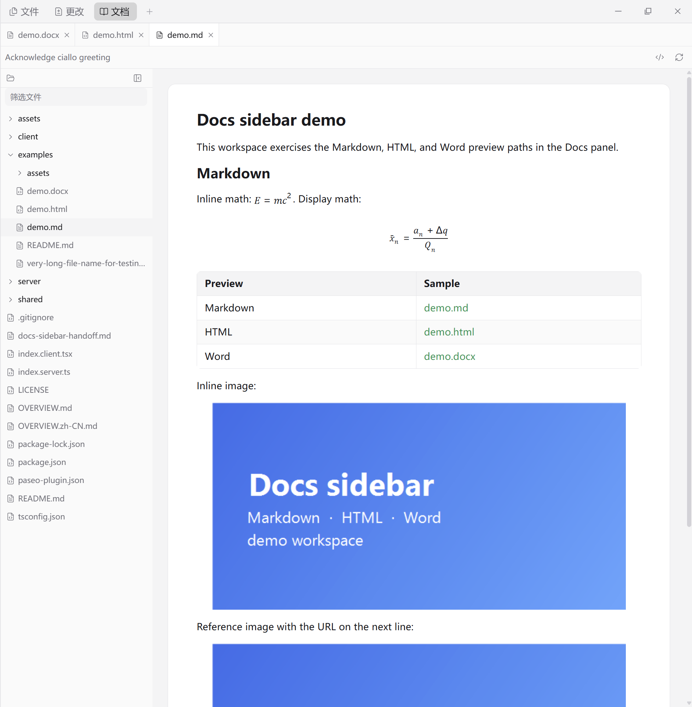

# Docs sidebar

A Paseo plugin that adds a document workspace to the right explorer: a workspace file tree, document tabs, and rendered previews.



## What it does

- Markdown rendered as a document, with a source toggle. Relative images load from the workspace.
- LaTeX math in Markdown (`$...$`, `$$...$$`, `\(...\)`, `\[...\]`) rendered on the desktop client.
- Word documents (`.docx`, `.docm`) as a simplified reading view with headings, basic formatting, tables, and embedded images on desktop.
- HTML and PDF previews in an isolated document frame on desktop.
- Find in the current document from the toolbar search field: Markdown preview, Markdown source, and Word reading views.
- Images inline; other text files as source.
- Relative document links in a Markdown preview open as new tabs in the same panel on the desktop client.
- Open documents, expanded folders, and tree visibility persist per explorer tab.
- The file tree divider can be dragged to resize it; the width persists per explorer tab.
- The explorer is workspace-scoped, so switching agent sessions keeps the document area.

## Requirements

- Paseo 0.17.4 or later.
- Desktop client for Word, HTML, PDF, and math previews. Markdown text and images work on other clients.

## Install

From the plugin marketplace (after approval):

```bash
paseo plugin add SyFu96/paseo-docs-sidebar
```

Directly from GitHub, which works before the listing is approved:

```bash
paseo plugin add git:SyFu96/paseo-docs-sidebar
```

From a local checkout:

```bash
paseo plugin install /absolute/path/to/docs-sidebar
```

Then open Paseo's command center and choose **Docs: open on the right**, or pick **Docs** from the explorer's new-tab menu.

Git and marketplace installs run the manifest's preparation command once, which installs the local KaTeX math renderer. A local checkout needs `npm install`.

## Demo workspace

The `examples/` folder is a small Paseo workspace with Markdown, HTML, and Word samples, including math, tables, images, a reference image whose URL is on the next line, and a long file name. Open the folder as a workspace to try the previews and drag the file tree divider.

## Development

```bash
npm install
npm run typecheck
paseo plugin install "$PWD"
paseo plugin reload docs-sidebar
```

The plugin has no separate build step. Paseo compiles the TypeScript entries and supplies the host modules (`react`, `react-native`, `zod`, `@tanstack/react-query`, `@getpaseo/plugin`) at runtime. Math rendering uses KaTeX on the daemon; `paseo-plugin.json` declares `npm ci --omit=dev --ignore-scripts` as the preparation command for Git and marketplace installs. For a local checkout, `npm install` keeps KaTeX available.

## How it works

- `index.client.tsx` registers a workspace panel in the explorer and two command-center entries.
- `client/docs-panel.tsx` renders the document tabs, toolbar (including the search field and match navigation), tree, and preview split.
- `client/file-tree.tsx` lazy-loads directories and searches file names.
- `client/preview.tsx` renders Markdown with Paseo's `Markdown` component, and HTML/PDF with `DocumentFrame`. It also runs the search for the toolbar field.
- `client/web.ts` implements Markdown text finding with the CSS Custom Highlight API.
- `client/docx-find.ts` and `server/docx-find.ts` find matches in the converted Word HTML and wrap them in anchor targets, so the sandboxed preview frame can highlight and scroll to each match.
- `server/math.ts` converts TeX math to MathML with KaTeX; `client/markdown-math.ts` and `client/web.ts` inject it after rendering.
- `index.server.ts` handles daemon-side RPCs for listing, reading, searching, converting Word files, finding text in Word files, and rendering math.
- `shared/docs.ts` defines the RPC contracts and file-kind helpers.

## Limits

- Word previews are a reading view: page layout, headers and footers, footnotes, equations, fields, and complex merged cells are not reproduced. Legacy `.doc` files are not supported, and macros in `.docm` files are not executed.
- The plugin has its own file tree. Files opened from Paseo's built-in Files tab still open in the center area.
- HTML previews do not run page scripts.
- Markdown relative image paths and document links resolve against the open file; paths outside the workspace are refused.
- Remote images in Markdown are replaced with a local placeholder. HTML previews block network resources with a content security policy; http(s) links open externally only when clicked.
- Math rendering needs the desktop client; other clients show the raw TeX. Unsupported TeX stays as text.
- Word, HTML, PDF, and math previews need the desktop client.
- Document find is available on the desktop client for Markdown and Word previews through the toolbar search field. It does not search HTML or PDF previews; use the PDF viewer's own find. Ctrl/Cmd+F stays with Paseo's workspace search, so the plugin does not override it.

## License

MIT. See [LICENSE](LICENSE). Math rendering uses [KaTeX](https://katex.org/), also MIT.
